

<!-- ======================================================================= -->
<!-- 00 // HERO SECTION: PIXEL RECONSTRUCTION PORTRAIT + CYBER TERMINAL HUD  -->
<!-- ======================================================================= -->

<a href="https://github.com/DhruvilPatel603">
  
</a>

 

<!-- ANIMATED TERMINAL COMMAND TICKER -->

 

<!-- COMMAND DOCK: SOCIALS & TELEMETRY -->

 

 

<!-- ======================================================================= -->
<!-- 01 // OPERATOR PROFILE: ASYMMETRICAL SPLIT-SCREEN TERMINAL + QUEST HUD  -->
<!-- ======================================================================= -->


 

  &nbsp;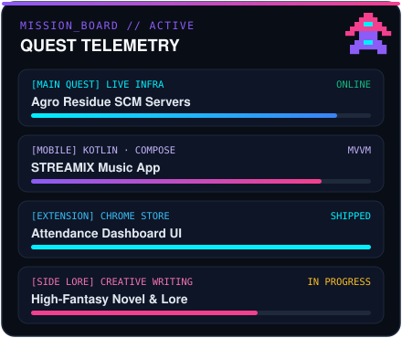

 

 

<!-- ======================================================================= -->
<!-- 02 // TECH ARSENAL: 2x2 FUTURISTIC TECHNOLOGY DASHBOARD                 -->
<!-- ======================================================================= -->


 

<table width="100%">
  <tr>
    <td width="50%" align="center" valign="top">
      <h4><code>01 // CORE_LANGUAGES</code></h4>
      

        
      

      

        
        
        
        
        
      

    </td>
    <td width="50%" align="center" valign="top">
      <h4><code>02 // MOBILE_&_FRONTEND</code></h4>
      

        
      

      

        
        
        
        
      

    </td>
  </tr>
  <tr>
    <td width="50%" align="center" valign="top">
      <h4><code>03 // BACKEND_&_DATA_CORE</code></h4>
      

        
      

      

        
        
        
        
      

    </td>
    <td width="50%" align="center" valign="top">
      <h4><code>04 // AI_PIPELINES_&_TOOLING</code></h4>
      

        
      

      

        
        
        
        
      

    </td>
  </tr>
</table>

 

 

<!-- ======================================================================= -->
<!-- 03 // DEPLOYED ARTIFACTS: FULL-WIDTH CLICKABLE CYBER PROJECT CARDS      -->
<!-- ======================================================================= -->


 

  <a href="https://chromewebstore.google.com/detail/attendance-dashboard-for/onpaadhefkkhnpogpkhncalieojnjjcf">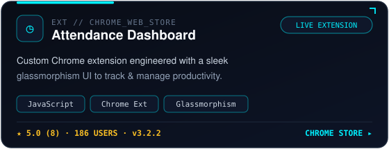</a>&nbsp;<a href="https://agroresiduescm.live/">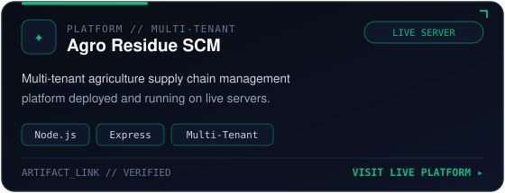</a>
   
  <a href="https://github.com/DhruvilPatel603">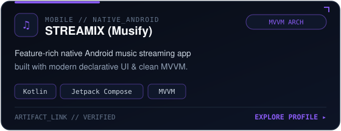</a>&nbsp;<a href="https://chromewebstore.google.com/detail/network-meter-%E2%80%94-speed-tes/pnlkbeccihfnohpkmjhekpgikdmaehad">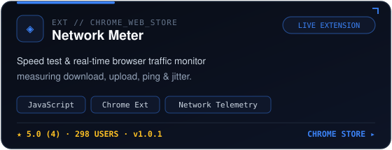</a>
   
  <a href="https://github.com/DhruvilPatel603/Chatbot">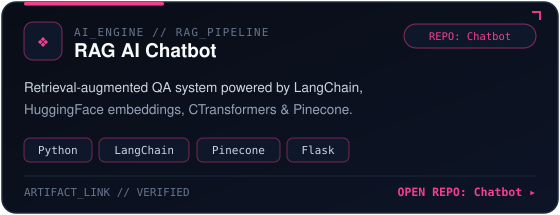</a>&nbsp;<a href="https://github.com/DhruvilPatel603/SpeakEasy">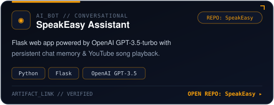</a>

 

 

<!-- ======================================================================= -->
<!-- 04 // OPEN SOURCE IMPACT: UPSTREAM PR MATRIX & REPO BREAKDOWN           -->
<!-- ======================================================================= -->


 

  <a href="https://github.com/pulls?q=is%3Apr+author%3ADhruvilPatel603">
    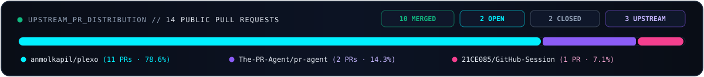
  </a>
   
  <a href="https://github.com/anmolkapil/plexo/pulls?q=is%3Apr+author%3ADhruvilPatel603">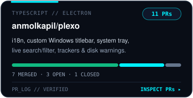</a>&nbsp;<a href="https://github.com/The-PR-Agent/pr-agent/pulls?q=is%3Apr+author%3ADhruvilPatel603">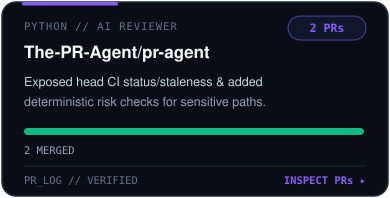</a>&nbsp;<a href="https://github.com/21CE085/GitHub-Session/pulls?q=is%3Apr+author%3ADhruvilPatel603">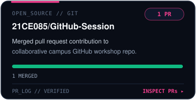</a>

 

 

<!-- ======================================================================= -->
<!-- 05 // SYSTEM TELEMETRY: GITHUB STATS, STREAK, LANGUAGES & PACMAN        -->
<!-- ======================================================================= -->


 

  &nbsp;
   
  &nbsp;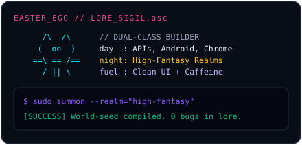

 

  

<picture>
  <source media="(prefers-color-scheme: dark)" srcset="https://raw.githubusercontent.com/DhruvilPatel603/DhruvilPatel603/output/pacman-contribution-graph-dark.svg" />
  <source media="(prefers-color-scheme: light)" srcset="https://raw.githubusercontent.com/DhruvilPatel603/DhruvilPatel603/output/pacman-contribution-graph.svg" />
  
</picture>

 

<!-- ======================================================================= -->
<!-- EOF // CYBER HORIZON FOOTER                                             -->
<!-- ======================================================================= -->

<a href="https://www.linkedin.com/in/dhruvil-patel-27a20725b/">
  
</a>
